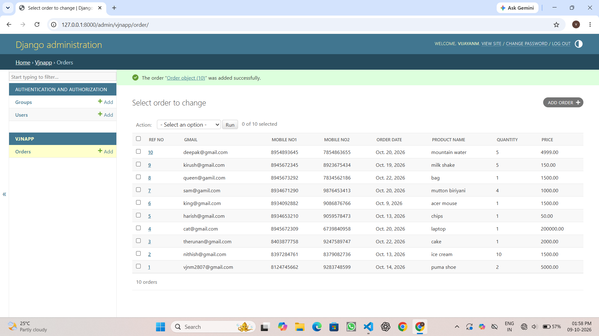

# Ex02 Django ORM Web Application
## Date: 9.10.2006

## AIM
To develop a Django Application to store and retrieve data from a Vehicle Service Database platform using Object Relational Mapping(ORM).

## ENTITY RELATIONSHIP DIAGRAM


## DESIGN STEPS

### STEP 1:
Clone the problem from GitHub

### STEP 2:
Create a new app in Django project

### STEP 3:
Enter the code for admin.py and models.py

### STEP 4:
Detect changes and create migration files that describe how to modify the database schema

### STEP 5:
Execute the migration files and update the database schema to match your Django models

### STEP 6:
Create a superuser with full access rights to all models and data through the admin interface.

### STEP 7:
Apply the migration files of the created app to the database

### STEP 8:
Execute Django admin using localhost and create details for 10 entries

## PROGRAM
```
models.py
from django.db import models
from django.contrib import admin

class Order(models.Model):
    Ref_No = models.AutoField(primary_key=True)
    Gmail = models.EmailField()
    Mobile_No1 = models.CharField(max_length=15)
    Mobile_No2 = models.CharField(max_length=15, blank=True, null=True)
    Order_Date = models.DateField()
    Product_Name = models.CharField(max_length=50)
    Quantity = models.PositiveIntegerField()
    Price = models.DecimalField(max_digits=10, decimal_places=2)

class OrderAdmin(admin.ModelAdmin):
    list_display = [ "Ref_No", "Gmail", "Mobile_No1","Mobile_No2", "Order_Date", "Product_Name", "Quantity", "Price"]
admin.py
from django.contrib import admin
from .models import Order,OrderAdmin
admin.site.register(Order,OrderAdmin)
```
## OUTPUT



## RESULT
Thus the program for creating Online Food Delivery Database using ORM hass been executed successfully
